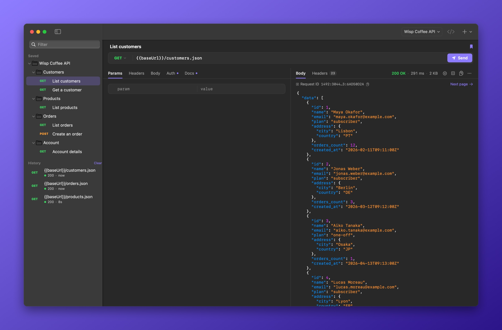
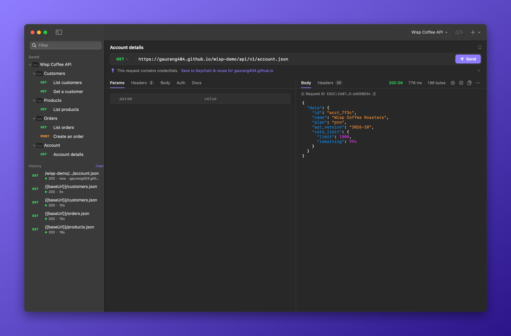
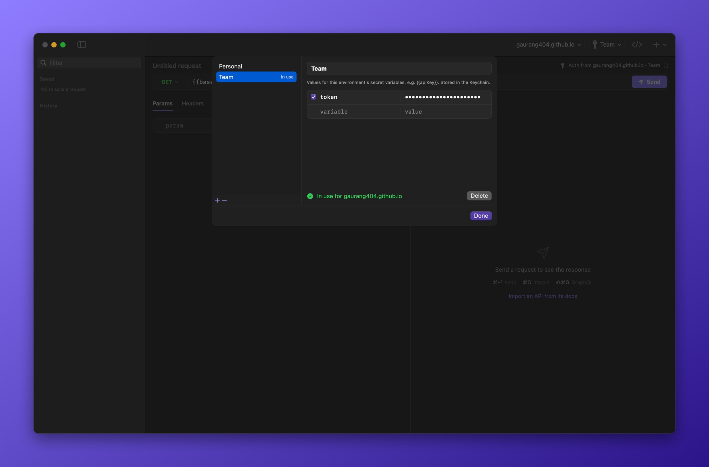
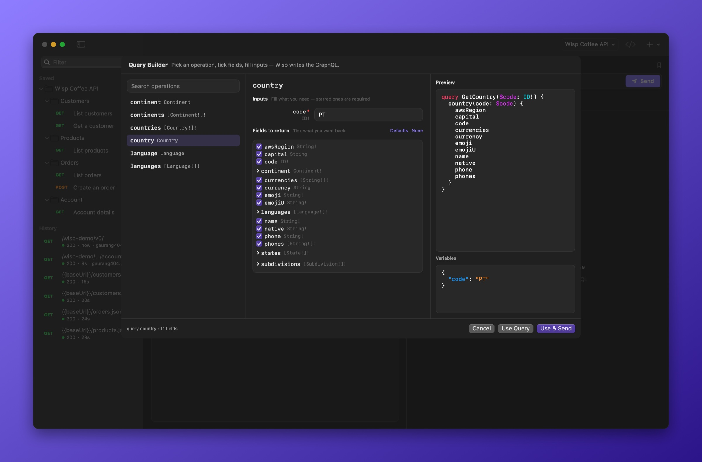
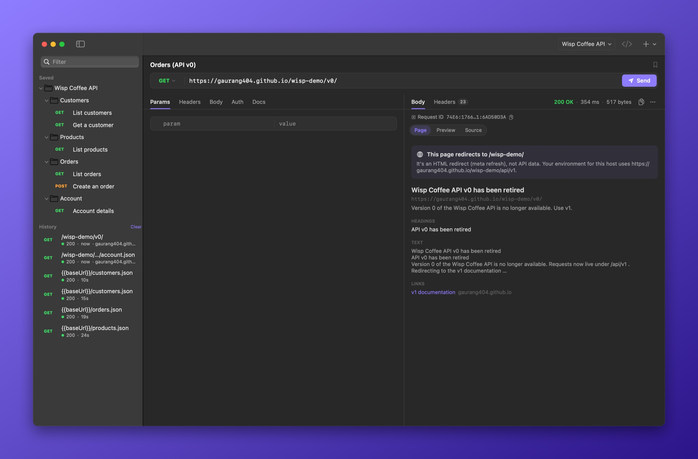
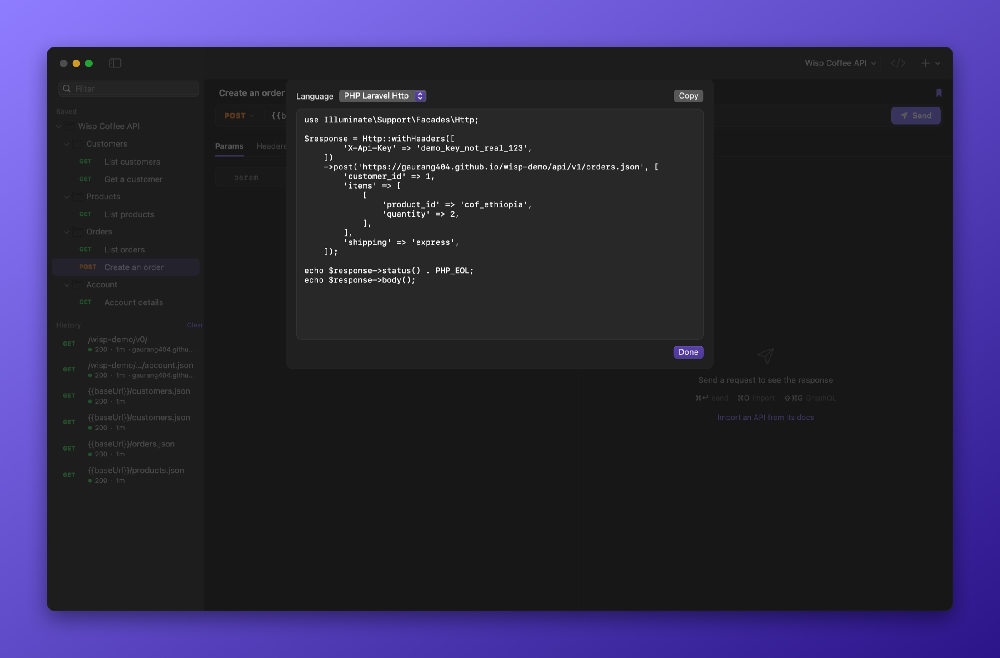

  

<h1 align="center">Wisp</h1>

  <b>A native API client for macOS.</b> 
  Keychain-backed credentials, schema-aware GraphQL, and OpenAPI import straight from docs pages.

  

  
  
  
  

  <a href="https://wisp.build">Website</a> ·
  <a href="#highlights">Highlights</a> ·
  <a href="#credentials-and-environments">Credentials</a> ·
  <a href="#import">Import</a> ·
  <a href="#graphql">GraphQL</a> ·
  <a href="#diagnostics">Diagnostics</a> ·
  <a href="#privacy">Privacy</a> ·
  <a href="#install">Install</a> ·
  <a href="BENCHMARKS.md">Performance</a>

<picture>
  <source media="(prefers-color-scheme: light)" srcset="docs/images/hero-light.jpg">
  
</picture>

## Highlights

- **Pasted secrets go to the Keychain.** Tokens in a pasted request move into Keychain-backed variables, scoped to their API's host, and are scrubbed from history.
- **One environment per API,** selected automatically from the URL's host, with auth and headers inherited by every request.
- **Several named keys per API** — switch between them from the toolbar and always see which one is in use.
- **OpenAPI import from a docs URL** — Wisp finds the spec behind Swagger UI, Redoc, Scalar or Stoplight pages.
- **Schema-aware GraphQL** with a query builder for operations, fields and typed inputs.
- **Failures explained:** auth challenges, HTML error pages and redirect chains are decoded for you.
- **Pagination, JSON path filters, and code generation** in eight languages.

## Credentials and environments

- **Secret detection on paste.** Bearer, Basic and API-key headers, auth fields and query keys (`api_key`, `access_token`) are recognised. One click moves them into Keychain-backed variables, rewrites the URL to `{{baseUrl}}/…`, and removes the literal value from history and saved requests.
- **Host-scoped environments.** Each environment belongs to its API's host. Opening a URL for that host selects it, and requests without their own auth inherit its auth and default headers. They are never attached to requests for another host — including cross-host redirects.
- **Named keys.** Keep several credentials for the same API — a personal key, a team key, a test account — and switch between them from the toolbar, which always shows the key in use. Pasting a request with a different key for the same host saves it alongside the existing one instead of replacing it. Rename or delete keys in *Manage Keys…*; a deleted key is removed from the Keychain and never sent again.

  

- **OAuth 2.** Authorization Code with PKCE over a local loopback redirect, Client Credentials and Password grants. Tokens are cached per client and refreshed automatically.
- **Variables everywhere.** `{{name}}` works in the URL, params, headers, body and auth. Mark a value secret to keep it in the Keychain.

## Import

- **From a docs page.** Wisp locates the OpenAPI/Swagger document behind Swagger UI, Redoc, Scalar, Stoplight Elements and RapiDoc pages, or at conventional paths such as `/openapi.json` and `/v3/api-docs`.
- **Formats.** OpenAPI 3.x and Swagger 2.0 (JSON or YAML), Postman v2.x, Insomnia v4, HAR and cURL. Operations are grouped by tag, request bodies are generated from schemas, security schemes become auth, and server URLs become `{{baseUrl}}`.

## GraphQL

- **Schema-aware.** The schema is introspected using the request's own auth and headers.
- **Query builder.** Browse queries and mutations, select fields across nested types, unions and interfaces, and fill typed inputs — enums and booleans as pickers. Wisp generates the operation and its variables, so there's no syntax to remember.
- **Errors surfaced.** GraphQL `errors` are shown with their line and path, even when the HTTP status is `200`.
- Formatting, highlighting, and cURL imports recognised as GraphQL.

## Diagnostics

- **Auth challenges decoded.** `401`/`407` responses are read from `WWW-Authenticate`: which scheme the API expects, or that the credentials sent were rejected.
- **HTML responses summarised** — title, headings, text and links — with the likely cause: a redirect, a sign-in page, a gateway error or a wrong path. A JavaScript-free preview and highlighted source are one click away.
- **Redirects listed hop by hop.** Turn off following to inspect the `3xx` itself.
- **Response insights:** rate-limit budgets, GraphQL query cost, deprecation notices, `Retry-After` and request IDs.

## Responses

- JSON pretty-printed in its original key order and highlighted — a 10 MB body formats in under 70 ms.
- **Path filters** such as `data.items[0].name`, `items.id` and `items.#`, and **capture to variable** for chaining requests without scripts.
- **Pagination** across `Link` headers, `next` URLs, cursors, `has_more` and page numbers.
- JWT decoding, image preview, find, raw view and save to file.

## Code generation

cURL, HTTPie, JavaScript `fetch`, Python `requests`, Laravel `Http`, PHP cURL, Go `net/http` and Swift `URLSession` — written idiomatically for each, such as `Http::withToken()->post()` with PHP arrays or `requests.post(json=…)`. Collections export as Markdown API docs with secrets masked.

## Also

- Saved requests in folders, searchable history, and Markdown notes on every request
- Light and dark appearance

| Shortcut | |
|---|---|
| ⌘↩ | Send |
| ⌘S | Save |
| ⌘N | New request |
| ⌘O | Import |
| ⇧⌘C | Copy as cURL |
| ⌥⌘C | Generate code |
| ⇧⌘G | GraphQL query builder |
| ⌥⌘E | Environments |

## Privacy

- No account, no cloud sync, no telemetry. Wisp only connects to the APIs you call.
- Secret variables and OAuth tokens are stored in the macOS Keychain; everything else in a single local file.
- Responses are never cached, and cookies aren't persisted between requests.

## Install

1. [Download Wisp](https://github.com/gaurang404/wisp/releases/latest/download/Wisp.dmg) and open the disk image.
2. Drag **Wisp** into your Applications folder and open it.

Requires macOS 14 Sonoma or later, on Apple silicon or Intel.

**Try it:** paste `https://gaurang404.github.io/wisp-demo/` into *Import* to load the Wisp Coffee demo API used in these screenshots.

---

[wisp.build](https://wisp.build) · [Performance](BENCHMARKS.md) · [Changelog](CHANGELOG.md) · [Development](DEVELOPMENT.md) · [Security](SECURITY.md) · [MIT License](LICENSE)
